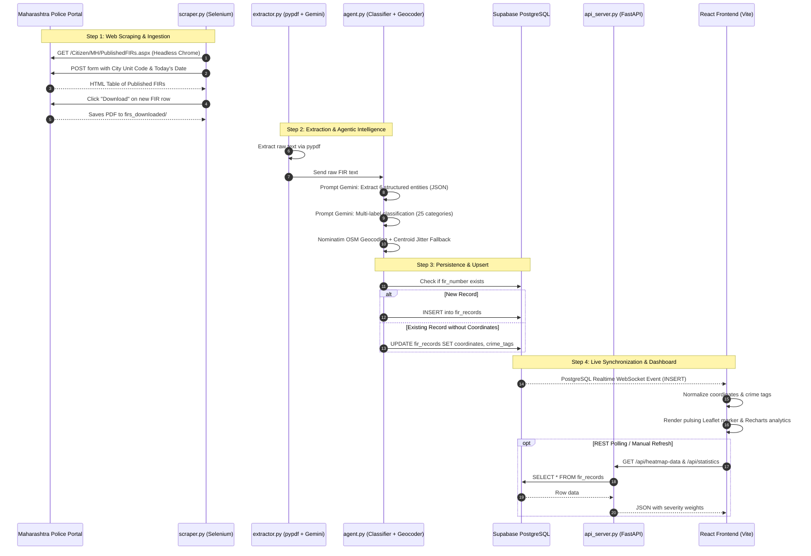

Listed directory BTP
Viewed README.md:1-85
Viewed requirements.txt:1-13
Listed directory dashboard
Listed directory src
Listed directory components
Viewed main.py:1-124
Viewed api_server.py:1-373
Viewed extractor.py:1-180
Viewed agent.py:1-456
Viewed database.py:1-65
Viewed scraper.py:1-263
Viewed view_records.py:1-21
Viewed fix_coordinates.py:1-57
Viewed reclassify_records.py:1-53
Viewed check_db.py:1-30
Viewed package.json:1-22
Viewed App.jsx:1-363
Viewed supabaseClient.js:1-7
Viewed CrimeMap.jsx:1-438
Viewed CrimeDistribution.jsx:1-123
Viewed CrimeTrend.jsx:1-106
Viewed RecordsTable.jsx:1-104
Viewed StatsCards.jsx:1-50
Viewed FiltersBar.jsx:1-48
Viewed Header.jsx:1-53
Viewed Sidebar.jsx:1-48
Viewed check_coords_format.py:1-16
Viewed .env.example:1-6

# Crime Watch: Automated Maharashtra Police FIR Ingestion, Intelligence & Geospatial Analytics System

Welcome to the complete architectural, codebase, and engineering masterclass for your Bachelor of Technology Project (**BTP**).

As your senior engineer, system architect, and technical mentor, this document breaks down every layer of your project so you can **build, explain, debug, and defend it during your project viva or technical interviews with 100% confidence**.

---

## Table of Contents
1. [Phase 1: Project Overview & Core Architecture](#phase-1-project-overview--core-architecture)
2. [Phase 2: Folder-by-Folder & File-by-File Breakdown](#phase-2-folder-by-folder--file-by-file-breakdown)
3. [Phase 3: The Complete Execution Flow & Data Pipeline](#phase-3-the-complete-execution-flow--data-pipeline)
4. [Phase 4: Deep Dive into the Backend & AI/ML Layer](#phase-4-deep-dive-into-the-backend--aiml-layer)
5. [Phase 5: Deep Dive into the React Frontend & Geospatial Visualization](#phase-5-deep-dive-into-the-react-frontend--geospatial-visualization)
6. [Phase 6: How to Run, Debug, Modify, and Test the Project](#phase-6-how-to-run-debug-modify-and-test-the-project)
7. [Phase 7: Project Viva & Technical Interview Questions](#phase-7-project-viva--technical-interview-questions)

---

## Phase 1: Project Overview & Core Architecture

### 1.1 Project Purpose
In India, hundreds of First Information Reports (**FIRs**) are filed across police stations every day. While state police portals (such as the Maharashtra Police Citizen Portal) make these documents accessible for transparency, they are stored as **unstructured, multi-page PDF documents** written in varying formats with legal terminology and police jargon.

**The Problem**: Law enforcement analysts, researchers, and citizens cannot easily search, aggregate, filter, or visualize crime patterns across cities or dates.

**Your Solution**: An end-to-end automated monitoring and analytics system that:
1. **Automates Web Ingestion**: Uses headless Selenium automation to crawl published FIRs across **5 key Maharashtra Commissionerate/District jurisdictions** (Pune, Mumbai Main, Thane, Nashik, Nagpur).
2. **Extracts Structured Intelligence with Generative AI**: Ingests unstructured legal PDF text and leverages **Google Gemini 3.1 Flash-Lite** via LangChain to extract entities (`fir_number`, `date`, `location`, `description`, `complainant`, `accused`).
3. **Applies an Agentic Enrichment Layer**:
   - **Multi-label Crime Classification**: Classifies incidents strictly into **25 standardized Indian penal crime categories** (with an intelligent IPC-section keyword fallback algorithm).
   - **Geographic Resolution (Geocoding)**: Resolves Marathi/English address strings into real-world geographic coordinates `(latitude, longitude)` via the OpenStreetMap Nominatim API, with deterministic centroid fallback and jitter algorithms.
4. **Cloud Database Storage**: Persists clean records to a cloud **Supabase PostgreSQL** database with deduplication and upsert handling.
5. **Dual Serving Architecture**:
   - **FastAPI REST API**: Serves analytical aggregations, time-series metrics, and severity-weighted heatmap data points.
   - **React/Vite Glassmorphic Dashboard**: An interactive SPA featuring real-time Supabase subscriptions, dynamic Leaflet heatmaps, severity pulse markers, and Recharts analytics.

---

### 1.2 Technology Stack Summary

| Domain | Technology / Library | Role & Purpose |
| :--- | :--- | :--- |
| **Orchestrator** | Python 3.10+ | Central pipeline coordinator and scheduler loop |
| **Web Scraping** | `selenium`, Chrome WebDriver, CDP | Automated browser automation, ASP.NET postback handling, PDF downloads |
| **PDF Extraction** | `pypdf`, Regex Fallback Engine | Extracting raw text streams from digital FIR documents |
| **LLM & Agentic AI** | `google-genai`, `langchain-google-genai`, Gemini 3.1 Flash-Lite | Zero-shot structured JSON extraction and 25-category crime classification |
| **Geospatial Engine** | OpenStreetMap Nominatim API, Leaflet.js, `leaflet.heat` | Address resolution to coordinates; rendering heatmaps & pulsing markers |
| **Cloud Database** | Supabase (PostgreSQL), `supabase-py`, `@supabase/supabase-js` | Relational storage, indexing, and WebSocket real-time change data capture |
| **Backend API** | FastAPI, Uvicorn, Pydantic, Python `Counter` | High-throughput asynchronous REST API for crime analytics and heatmap data |
| **Frontend UI** | React 19, Vite, Recharts, Custom Glassmorphic CSS | Interactive Single Page Application for monitoring and filtering |

---

## Phase 2: Folder-by-Folder & File-by-File Breakdown

```
BTP/
│
├── .env                              # Active environment variables (API keys, DB credentials)
├── .env.example                      # Template showing required config keys
├── requirements.txt                  # Python dependencies
├── README.md                         # Project documentation
│
├── main.py                           # 🚀 Pipeline Orchestrator (entry point)
├── scraper.py                        # 🌐 Selenium scraper for Maharashtra Police Portal
├── extractor.py                      # 📄 PDF text extractor + Gemini LLM entity parsing
├── agent.py                          # 🤖 Crime classification & OpenStreetMap geocoding
├── database.py                       # 🗄️ Supabase client initialization & CRUD logic
├── api_server.py                     # ⚡ FastAPI REST API backend (Port 5000)
│
├── check_db.py                       # 🛠️ Diagnostic utility to check DB records & coordinates
├── check_coords_format.py            # 🛠️ Diagnostic utility to inspect coordinate JSON types
├── fix_coordinates.py                # 🛠️ Maintenance utility to geocode unmapped records
├── reclassify_records.py             # 🛠️ Maintenance utility to reclassify past records
├── view_records.py                   # 🛠️ CLI utility to inspect raw records from Supabase
│
├── firs_downloaded/                  # 📂 Directory where real scraped PDFs are saved
├── firs/                             # 📂 Secondary storage folder for FIR documents
│
└── dashboard/                        # 💻 React + Vite Frontend Application
    ├── package.json                  # NPM packages & build scripts
    ├── index.html                    # Root HTML file mounting the React app
    ├── vite.config.js / tsconfig.json# Vite and TypeScript compiler configurations
    └── src/
        ├── main.jsx                  # React application entry point (ReactDOM render)
        ├── App.jsx                   # Central component: state, filters, Supabase Realtime
        ├── supabaseClient.js         # Supabase client instantiation for browser
        ├── index.css                 # Primary glassmorphic stylesheet & animations
        └── components/
            ├── Header.jsx            # Top navbar: active tab, live clock, refresh button
            ├── Sidebar.jsx           # Left navigation: page switching & DB status
            ├── StatsCards.jsx        # Top metric cards (Total, Geocoded %, Cities, Top Crime)
            ├── FiltersBar.jsx        # City and Crime Category filter dropdowns
            ├── CrimeMap.jsx          # Leaflet map: dark mode, satellite, heatmap & markers
            ├── CrimeTrend.jsx        # Recharts area chart: incident trends over time
            ├── CrimeDistribution.jsx # Recharts bar chart: 25-category breakdown
            └── RecordsTable.jsx      # Tabular view of FIRs with color-coded tags
```

---

### Detailed Walkthrough of Root & Pipeline Files

#### 1. [main.py](file:///c:/Users/mahit/OneDrive/Desktop/BTP/main.py) — The Pipeline Orchestrator
- **Role**: Serves as the master entry point for the background data gathering pipeline.
- **Key Functions**:
  - `run_pipeline()`: Executes the 4-stage pipeline:
    1. Scrapes PDFs via [scraper.py](file:///c:/Users/mahit/OneDrive/Desktop/BTP/scraper.py).
    2. Extracts structured records via [extractor.py](file:///c:/Users/mahit/OneDrive/Desktop/BTP/extractor.py).
    3. Runs crime classification and geocoding via [agent.py](file:///c:/Users/mahit/OneDrive/Desktop/BTP/agent.py).
    4. Upserts records into PostgreSQL via [database.py](file:///c:/Users/mahit/OneDrive/Desktop/BTP/database.py).
  - `main()`: Contains an infinite loop (`while True`) with an auto-refresh timer configured to **3 Hours** (`10800 seconds`), or runs once if invoked with the `--once` CLI flag.
- **Encoding Safety**: Configures standard output/error to `utf-8` using `sys.stdout.reconfigure(encoding="utf-8")` to prevent Windows `cp1252` encoding crashes when printing Marathi characters.

#### 2. [scraper.py](file:///c:/Users/mahit/OneDrive/Desktop/BTP/scraper.py) — Headless Portal Scraper
- **Role**: Automates file downloads from the official Maharashtra Police Citizen Portal (`citizen.mahapolice.gov.in/Citizen/MH/PublishedFIRs.aspx`).
- **Target Units**:
  - `Pune`: `PUNE CITY` (District Code: `19393`)
  - `Mumbai Main`: `BRIHAN MUMBAI CITY` (District Code: `19378`)
  - `Thane`: `THANE CITY` (District Code: `19399`)
  - `Nashik`: `NASHIK CITY` (District Code: `19408`)
  - `Nagpur`: `NAGPUR CITY` (District Code: `19387`)
- **Key Functions**:
  - `init_chrome_driver(download_dir)`: Spawns a headless Google Chrome instance using Selenium. Crucially configures Chrome DevTools Protocol (`Page.setDownloadBehavior` and `Browser.setDownloadBehavior`) to allow headless file downloads directly into `firs_downloaded/`.
  - `wait_for_new_pdf_download(download_dir, before_files)`: Polls the directory until the temporary `.crdownload` file finishes writing and the file size stabilizes (> 1000 bytes).
  - `scrape_firs()`: Navigates to the portal, establishes ASP.NET session cookies, selects the city unit code, injects today's registration dates, triggers ASP.NET postbacks, parses the `#ContentPlaceHolder1_gdvDeadBody` grid table, and triggers the download button for new FIRs.

#### 3. [extractor.py](file:///c:/Users/mahit/OneDrive/Desktop/BTP/extractor.py) — Document Ingestion & LLM Parsing
- **Role**: Reads the binary PDF documents and parses unstructured police text into structured JSON.
- **Key Functions**:
  - `extract_text_from_pdf(pdf_path)`: Uses `pypdf.PdfReader` to extract textual content from all pages of the PDF. If the file is plain text or mock format, it falls back to raw text reading.
  - `extract_structured_data(pdf_text)`: Builds a LangChain pipeline using `ChatGoogleGenerativeAI(model="gemini-3.1-flash-lite", temperature=0)`. Prompts Gemini to return a raw JSON object extracting: `fir_number`, `date`, `location`, `description`, `complainant`, and `accused`.
  - `_regex_extract_fallback(text)`: An intelligent regular expression engine that extracts fields using pattern matching (`r'FIR No:\s*([^\n,]+)'`, `r'Place of Occurrence:\s*([^\n]+)'`, etc.) if Gemini's API is temporarily unreachable or rate-limited.
  - `process_pdfs(download_dir, target_files)`: Checks against Supabase to see which FIR numbers already exist in the database with coordinates. **It skips cached FIRs to save Gemini API quota and speed up processing**.

#### 4. [agent.py](file:///c:/Users/mahit/OneDrive/Desktop/BTP/agent.py) — Agentic Intelligence & Geospatial Resolution
- **Role**: Enriches extracted FIR records with multi-label crime taxonomy and exact geographic coordinates.
- **Predefined Taxonomy**: Enforces **25 official crime categories** (`Theft`, `Burglary / Housebreaking`, `Robbery`, `Snatching`, `Vehicle Theft`, `Cheating / Fraud`, `Cybercrime`, `Online Financial Fraud`, `Assault / Physical Attack`, `Murder`, `Attempt to Murder`, `Kidnapping / Abduction`, `Missing Person`, `Rape`, `Sexual Harassment`, `Stalking`, `Domestic Violence / Cruelty`, `Dowry-related Offences`, `Criminal Intimidation`, `Criminal Trespass`, `Property Damage / Vandalism`, `Forgery / Document Fraud`, `Bribery / Corruption`, `Drug-related Offences`, `Human Trafficking`).
- **Key Functions**:
  - `classify_crime(description)`: Uses Gemini 3.1 Flash-Lite to evaluate the incident description against the 25 categories.
  - `_normalize_category(tag_str)`: Normalizes casing, punctuation, and aliases (e.g., mapping `"dowry death"` to `"Dowry-related Offences"`, `"cyber crime"` to `"Cybercrime"`).
  - `_keyword_classify_fallback(description)`: A comprehensive legal keyword matcher based on Indian Penal Code (IPC) sections (e.g., 302/307 for Murder/Attempt, 379 for Theft, 420 for Fraud, 498A for Domestic Violence, NDPS for Drug offenses).
  - `geocode_location(location_name)`: Sends progressive query candidates to the OpenStreetMap Nominatim search API.
  - `_city_centroid_fallback(location_name)`: If Nominatim cannot resolve a specific street address, this function matches the city/locality against `CITY_CENTROIDS` (Pune, Mumbai, Thane, Nashik, Nagpur, Dadar, Andheri, Shivajinagar, etc.) and injects **deterministic pseudo-random jitter** based on an MD5 hash of the location string. This prevents 20 incidents in Pune from collapsing onto the exact same GPS coordinate.

#### 5. [database.py](file:///c:/Users/mahit/OneDrive/Desktop/BTP/database.py) — Supabase PostgreSQL CRUD Operations
- **Role**: Handles database connections and data persistence.
- **Key Functions**:
  - `get_supabase_client()`: Reads `SUPABASE_URL` and `SUPABASE_KEY` from `.env` and initializes a `Client`.
  - `save_to_database(records, table_name="fir_records")`:
    - Checks if an FIR with the same `fir_number` already exists in `fir_records`.
    - If it exists but is missing coordinates, it executes an **UPDATE** operation to attach the new heat coordinates and crime tags.
    - If it already has coordinates, it skips duplicate insertion.
    - If it is new, it executes an **INSERT** operation.
    - If credentials are not set, it provides mock output so the pipeline does not fail during offline testing.

#### 6. [api_server.py](file:///c:/Users/mahit/OneDrive/Desktop/BTP/api_server.py) — FastAPI Backend Server
- **Role**: High-performance REST API running on port 5000, serving data to the React dashboard.
- **Endpoints**:
  - `GET /`: Server info and link to Swagger UI (`/docs`).
  - `GET /api/records`: Fetches FIR records with query parameters `?city=Pune&crime=Theft&limit=50`.
  - `GET /api/statistics`: Aggregates total FIR count, geocoded ratio, today's count, city counters, and top 10 crime categories.
  - `GET /api/crime-distribution`: Aggregates frequency counts for all 25 categories for charting.
  - `GET /api/city-distribution`: Aggregates FIR counts for Pune, Mumbai, Thane, Nashik, Nagpur, and Other.
  - `GET /api/trend`: Parses multiple date formats (`DD/MM/YYYY`, `YYYY-MM-DD`, ISO timestamps) to provide day-by-day frequency trends.
  - `GET /api/heatmap-data`: Returns array of `[lat, lng, intensity, fir_number, location, tags]`. Dynamically calculates **intensity weights** based on crime severity (e.g., Murder = 1.0, Kidnapping = 0.9, Robbery = 0.85, General = 0.5).
  - `GET /api/health`: Verifies live database connectivity.

#### 7. Utility & Maintenance Scripts
- [view_records.py](file:///c:/Users/mahit/OneDrive/Desktop/BTP/view_records.py): Connects to Supabase and dumps all stored FIRs to the terminal in formatted JSON.
- [check_db.py](file:///c:/Users/mahit/OneDrive/Desktop/BTP/check_db.py): Audits the database, showing total records, how many have valid heat coordinates, and listing any unmapped records.
- [fix_coordinates.py](file:///c:/Users/mahit/OneDrive/Desktop/BTP/fix_coordinates.py): Scans for records with missing coordinates, resolves them using `geocode_location()`, and updates the rows in Supabase.
- [reclassify_records.py](file:///c:/Users/mahit/OneDrive/Desktop/BTP/reclassify_records.py): Re-runs all existing incident descriptions through the 25-category classifier and updates outdated tags.
- [check_coords_format.py](file:///c:/Users/mahit/OneDrive/Desktop/BTP/check_coords_format.py): Verifies that coordinate objects are stored as proper JSONB structures (`{"lat": float, "lng": float}`) rather than escaped strings.

---

## Phase 3: The Complete Execution Flow & Data Pipeline

Below is the complete end-to-end data lifecycle from official police publication to map rendering.



---

## Phase 4: Deep Dive into the Backend & AI/ML Layer

### 4.1 Server Initialization & Middleware Architecture
In [api_server.py](file:///c:/Users/mahit/OneDrive/Desktop/BTP/api_server.py), the FastAPI instance is initialized as:
```python
app = FastAPI(
    title="Crime Watch Maharashtra FIR API",
    description="FastAPI REST API serving FIR records and crime analytics from Supabase",
    version="1.0.0",
)
```

#### Cross-Origin Resource Sharing (CORS)
When the React frontend (running on `http://localhost:5173`) requests resources from the FastAPI backend (running on `http://localhost:5000`), the browser enforces the **Same-Origin Policy**.
To allow cross-origin requests, CORS middleware is registered:
```python
app.add_middleware(
    CORSMiddleware,
    allow_origins=["*"],
    allow_credentials=True,
    allow_methods=["*"],
    allow_headers=["*"],
)
```
- `allow_origins=["*"]`: Permits requests from any origin (can be restricted to `["http://localhost:5173"]` in production).
- `allow_methods=["*"]`: Supports `GET`, `POST`, `OPTIONS`, `PUT`, etc.
- `allow_headers=["*"]`: Allows authorization tokens and custom headers.

---

### 4.2 Database Architecture & Schema (Supabase PostgreSQL)

Your database table is named `fir_records`. Here is the schema structure:

| Column Name | Data Type | Constraints / Details | Description |
| :--- | :--- | :--- | :--- |
| `id` | `BIGINT` or `UUID` | Primary Key, Auto-increment | Unique internal database ID |
| `fir_number` | `TEXT` | Not Null, Indexed | Official FIR registration number (e.g. `"0248/2026"`) |
| `date` | `TEXT` | Nullable | Registration date or incident date (e.g. `"26/10/2026"`) |
| `location` | `TEXT` | Nullable | Textual place of occurrence |
| `description` | `TEXT` | Nullable | Narrative summary of the criminal incident |
| `complainant` | `TEXT` | Nullable | Name of victim or reporting police officer |
| `accused` | `TEXT` | Nullable | Name or description of accused / suspects |
| `crime_tags` | `JSONB` or `TEXT[]`| Default `[]` | Array of classified crime categories |
| `coordinates` | `JSONB` | Nullable | Nested JSON: `{"lat": 18.5204, "lng": 73.8567}` |
| `created_at` | `TIMESTAMPTZ` | Default `now()` | Timestamp of insertion into database |

#### Deduplication & Upsert Logic
In [database.py](file:///c:/Users/mahit/OneDrive/Desktop/BTP/database.py#L37-L62):
```python
existing = supabase.table(table_name).select("id, coordinates").eq("fir_number", fir_no).execute()
if existing.data and len(existing.data) > 0:
    existing_row = existing.data[0]
    # If the record previously had no coordinates, patch it
    if not existing_row.get("coordinates") and record.get("coordinates"):
        supabase.table(table_name).update({
            "coordinates": record.get("coordinates"),
            "crime_tags": record.get("crime_tags", []),
        }).eq("id", existing_row["id"]).execute()
```
This ensures the pipeline is **idempotent**: running the scraper multiple times in a day will not create duplicate entries for the same FIR.

---

### 4.3 AI & Machine Learning Implementation

The project uses a **hybrid AI architecture**: LLM-based zero-shot extraction coupled with deterministic rule-based fallback engines.

```
                  ┌────────────────────────────────────────┐
                  │          Raw Incident Text             │
                  └──────────────────┬─────────────────────┘
                                     │
                     Is GEMINI_API_KEY available?
                                    / \
                             YES   /   \  NO / Error
                                  /     \
                                 ▼       ▼
        ┌───────────────────────────┐  ┌───────────────────────────┐
        │  Gemini 3.1 Flash-Lite    │  │  Regex & IPC Keyword      │
        │  (Temperature: 0, LangChain)│  │  Rule-based Engine        │
        └─────────────┬─────────────┘  └─────────────┬─────────────┘
                      │                              │
                      └──────────────┬───────────────┘
                                     ▼
                      ┌──────────────────────────────┐
                      │    Canonical Normalization   │
                      │  (Maps to 25 Crime Classes)  │
                      └──────────────────────────────┘
```

#### 1. Structured Data Extraction Prompt ([extractor.py](file:///c:/Users/mahit/OneDrive/Desktop/BTP/extractor.py#L88-L104))
- **Model**: `gemini-3.1-flash-lite` via `ChatGoogleGenerativeAI`.
- **Hyperparameters**: `temperature=0` (ensures deterministic output), `timeout=25`, `max_retries=1`.
- **Input text truncation**: `pdf_text[:8000]` to avoid token overflow.
- **Prompt Strategy**: Few-shot / strict JSON role prompting:
  > *"You are an expert at parsing police First Information Reports (FIRs) in India. Extract the following information... and return it strictly as a JSON object. Do not include markdown formatting like \`\`\`json."*

#### 2. Multi-Label Classification ([agent.py](file:///c:/Users/mahit/OneDrive/Desktop/BTP/agent.py#L47-L65))
- Police incidents often involve multiple offenses simultaneously (e.g., snatching a gold chain at knifepoint is both `Snatching` and `Robbery`; online phishing is both `Cybercrime` and `Online Financial Fraud`).
- The prompt provides the 25 strict categories and instructs the model to return a comma-separated list of matches.
- `_normalize_category()` strips numbering, bullet points, and cleans common variations (e.g., mapping `"financial fraud"` to `"Online Financial Fraud"`).

#### 3. Deterministic IPC Keyword Fallback ([agent.py](file:///c:/Users/mahit/OneDrive/Desktop/BTP/agent.py#L136-L255))
If an API error occurs, Gemini hits quota limits, or offline execution is required, `_keyword_classify_fallback()` scans for exact legal signals and Indian Penal Code sections:
- Section 302 / "murder" $\rightarrow$ `Murder`
- Section 307 / "attempted murder" $\rightarrow$ `Attempt to Murder`
- Section 379 / "stole parked motorcycle" $\rightarrow$ `Vehicle Theft` & `Theft`
- Section 392/395 / "at knifepoint", "looted" $\rightarrow$ `Robbery`
- Section 420 / "fake promise", "deceived" $\rightarrow$ `Cheating / Fraud`
- OTP / "unauthorized transaction", "phishing" $\rightarrow$ `Online Financial Fraud` & `Cybercrime`
- Section 498A / "cruelty by husband", "dowry" $\rightarrow$ `Domestic Violence / Cruelty`

---

### 4.4 Geospatial Geocoding & Centroid Jitter Algorithm

Geocoding raw Indian police addresses is challenging because FIR text may specify obscure landmarks (e.g., *"Near Maruti Mandir, Lane No 4, Vadgaonsheri"*).

#### Progressive Candidate Resolution ([agent.py](file:///c:/Users/mahit/OneDrive/Desktop/BTP/agent.py#L377-L426))
The system tries queries in order of decreasing specificity:
1. `"<location_name>, Maharashtra, India"`
2. `"<location_name>"`
3. Comma-separated parent parts (e.g., `"Pune, Maharashtra, India"`)
4. Base city name: `"Pune, Maharashtra, India"`

#### Deterministic Centroid Jitter ([agent.py](file:///c:/Users/mahit/OneDrive/Desktop/BTP/agent.py#L354-L375))
If all Nominatim HTTP requests fail or timeout, the system uses guaranteed coordinates from `CITY_CENTROIDS`.
To prevent multiple incidents in the same city from stacking on identical coordinates, it calculates an offset based on the MD5 hash of the location string:
```python
h = int(hashlib.md5(str(location_name).encode("utf-8")).hexdigest(), 16)
jitter_lat = ((h % 1000) / 1000.0 - 0.5) * 0.015
jitter_lng = (((h // 1000) % 1000) / 1000.0 - 0.5) * 0.015
return {
    "lat": round(coords["lat"] + jitter_lat, 6),
    "lng": round(coords["lng"] + jitter_lng, 6),
}
```
**Why this matters**:
- It is **deterministic**: The same location always maps to the same spot.
- It is **visually accurate**: Points scatter naturally across the city without artificial clustering or clumping.

---

## Phase 5: Deep Dive into the React Frontend & Geospatial Visualization

The frontend is built with React 19 and Vite.

### 5.1 Dual-Channel Data Architecture
The frontend can ingest data through two channels:
1. **Direct Supabase Realtime Channel** ([App.jsx](file:///c:/Users/mahit/OneDrive/Desktop/BTP/dashboard/src/App.jsx#L103-L152)):
   ```javascript
   const channel = supabase
     .channel('fir-realtime')
     .on('postgres_changes', { event: 'INSERT', schema: 'public', table: 'fir_records' }, (payload) => {
       const newRecord = normalizeRecord(payload.new);
       setRecords(prev => [newRecord, ...prev]);
     })
     .subscribe();
   ```
   When the Python scraper inserts a new FIR into Supabase, the PostgreSQL engine pushes a change event over a WebSocket directly to the client. The dashboard updates without requiring a page refresh.
2. **FastAPI REST Endpoints**: Used for aggregated statistics, time trends, and severity-weighted heatmap coordinates.

---

### 5.2 Leaflet Map & Custom Heatmap Layer ([CrimeMap.jsx](file:///c:/Users/mahit/OneDrive/Desktop/BTP/dashboard/src/components/CrimeMap.jsx))

#### Custom SVG Pulsing Markers
Instead of generic Leaflet pins, `createColoredIcon()` generates dynamic `L.divIcon` markers:
- Outer ring with CSS keyframe animation (`marker-pulse 2s infinite ease-out`).
- Inner circle colored by severity:
  - **Red (`#ef4444`)**: Violent crimes (`Murder`, `Attempt to Murder`, `Rape`, `Kidnapping`, `Human Trafficking`).
  - **Amber (`#f59e0b`)**: Serious crimes (`Robbery`, `Assault`, `Drug-related Offences`, `Snatching`).
  - **Blue (`#3b82f6`)**: Property, cyber, and financial crimes (`Theft`, `Cybercrime`, `Cheating`).

#### Dynamic Heatmap Layer
The `HeatmapLayer` subcomponent integrates the `leaflet.heat` plugin:
- Extracts `[lat, lng, intensity]` from filtered points.
- Configures radius (`28px`), blur (`20px`), and a 5-stop color gradient:
  - `0.2`: Blue $\rightarrow$ `0.4`: Green $\rightarrow$ `0.6`: Amber $\rightarrow$ `0.8`: Orange-Red $\rightarrow$ `1.0`: Crimson.

#### Multi-Provider Base Layers
Users can switch between map tiles without requiring third-party API keys:
1. **Dark Mode**: High-contrast OpenStreetMap tiles with dark CSS filters.
2. **Streets**: Standard OpenStreetMap tiles.
3. **Satellite**: Free Esri ArcGIS World Imagery.
4. **CARTO Dark**: Vector dark tiles (supports custom API keys via modal).

---

## Phase 6: How to Run, Debug, Modify, and Test the Project

### 6.1 Prerequisites
- Python 3.10+ installed.
- Node.js 18+ and npm installed.
- Google Chrome browser installed (for the Selenium scraper).

---

### 6.2 Configuration Setup (`.env`)
Create a `.env` file in the project root directory:
```env
GEMINI_API_KEY="your_actual_google_gemini_api_key"
SUPABASE_URL="https://your_project.supabase.co"
SUPABASE_KEY="your_supabase_anon_service_key"
```

---

### 6.3 Step-by-Step Execution Guide

#### Terminal 1: Run the Backend API Server
```powershell
# Navigate to project root
cd c:\Users\mahit\OneDrive\Desktop\BTP

# Activate your Python virtual environment if applicable, then install dependencies
pip install -r requirements.txt

# Start the FastAPI server
python api_server.py
```
*The API is now live at `http://localhost:5000`. You can inspect endpoints and test queries via the interactive documentation at `http://localhost:5000/docs`.*

#### Terminal 2: Run the React Dashboard
```powershell
# Navigate into dashboard directory
cd c:\Users\mahit\OneDrive\Desktop\BTP\dashboard

# Install npm dependencies (first time only)
npm install

# Start Vite dev server
npm run dev
```
*The dashboard will be available at `http://localhost:5173`.*

#### Terminal 3: Run the Data Pipeline
```powershell
# Navigate to project root
cd c:\Users\mahit\OneDrive\Desktop\BTP

# To run a single pipeline execution:
python main.py --once

# Or to run the continuous automated background monitor (auto-refreshes every 3 hours):
python main.py
```

---

### 6.4 Debugging & Maintenance Utilities

| If you want to... | Run this command | What it does |
| :--- | :--- | :--- |
| **Inspect all DB records** | `python view_records.py` | Queries Supabase and dumps formatted JSON of all stored FIRs to the terminal. |
| **Check coordinate integrity** | `python check_db.py` | Audits the database, reports total FIR count, count of heat-ready records, and lists any missing coordinates. |
| **Fix records missing coordinates** | `python fix_coordinates.py` | Geocodes any records lacking `lat`/`lng` and updates them in Supabase. |
| **Reclassify crime tags** | `python reclassify_records.py` | Re-evaluates incident descriptions using the 25 official categories and updates database tags. |
| **Test only scraping** | `python scraper.py` | Runs the Selenium scraper directly for the 5 target cities without running the rest of the pipeline. |

---

### 6.5 Common Troubleshooting Scenarios

1. **Selenium Chrome Crashes**:
   - *Cause*: Mismatched Chrome browser and ChromeDriver versions.
   - *Fix*: In modern Selenium 4.x, the driver is managed automatically via Selenium Manager. Ensure Google Chrome is up to date. If running in a headless VM or Docker, add `--no-sandbox` and `--disable-dev-shm-usage` (already configured in `scraper.py`).
2. **Windows Unicode Printing Crashes (`charmap codec can't encode characters`)**:
   - *Cause*: Windows `cmd.exe` or PowerShell defaults to `cp1252` encoding and cannot print Devanagari/Marathi characters.
   - *Fix*: Handled automatically in `main.py`, `extractor.py`, and `scraper.py` via `sys.stdout.reconfigure(encoding="utf-8")`.
3. **Gemini API Rate Limiting (429 Too Many Requests)**:
   - *Cause*: Hitting Google AI Studio free tier limits.
   - *Fix*: `extractor.py` and `agent.py` automatically fall back to regex entity extraction and keyword-based classification so the pipeline continues uninterrupted.
4. **Heatmap Points Not Showing**:
   - *Fix*: Run `python check_db.py`. If records show `missing coordinates`, run `python fix_coordinates.py` to populate them.

---

## Phase 7: Project Viva & Technical Interview Questions

Use these questions and answers to prepare for your project viva or technical interview.

### Category 1: System Architecture & Design

**Q1: What is the high-level architecture of your project?**
> *"The project follows a decoupled, multi-tier data pipeline architecture. The ingestion tier uses Selenium to crawl government portals and download raw PDFs. The processing tier uses pypdf for text extraction, Google Gemini for structured parsing, and an agentic layer for multi-label classification and Nominatim geocoding. The persistence tier uses a cloud Supabase PostgreSQL database. The serving tier consists of a FastAPI REST backend and a React/Vite dashboard that displays live updates via Supabase Realtime WebSockets."*

**Q2: Why did you separate the pipeline (`main.py`) from the API server (`api_server.py`) instead of combining them?**
> *"This follows the Single Responsibility Principle and separation of concerns. Ingestion is an I/O-heavy, batch-oriented background process that runs on a schedule (every 3 hours) and can take several minutes due to portal downloads and LLM calls. The API server must remain lightweight, non-blocking, and highly responsive to serve frontend requests in milliseconds. Combining them in a single thread would block HTTP requests during scraping runs."*

**Q3: How does the system prevent duplicate records across multiple runs?**
> *"The system implements an idempotent upsert workflow in `database.py`. Before inserting, it queries `fir_records` for matching `fir_number` entries. If a record already exists with valid coordinates, it skips insertion. If a record exists but lacks coordinates, it updates the row with the newly resolved coordinates and crime tags."*

---

### Category 2: AI, Machine Learning & NLP

**Q4: Why use an LLM for structured extraction instead of regular expressions?**
> *"First Information Reports in India do not adhere to a rigid, machine-readable standard. Different police stations format their documents differently, varying between English and Marathi, using diverse date formats, and writing descriptions in narrative free-text. While regular expressions work on fixed templates, an LLM handles semantic variation, OCR noise, and syntax inconsistencies across police units."*

**Q5: What happens if the Gemini API is down, rate-limited, or the user has no API key?**
> *"The system uses a two-tier fallback design. In `extractor.py`, if the Gemini API call fails, execution falls back to `_regex_extract_fallback()`. Similarly, in `agent.py`, crime classification falls back to `_keyword_classify_fallback()`, an Indian Penal Code rule-based engine that maps keywords and statutory section numbers (e.g., 302, 307, 379, 420, 498A) to our 25 official categories."*

**Q6: What prompt engineering techniques did you use in `agent.py`?**
> *"We used role prompting, strict constraint definition, and zero-shot constrained categorization. We provided Gemini with an enumerated list of the 25 allowed categories and enforced strict output formatting: no markdown wrappers, no introductory text, and only exact category names separated by commas. We also set `temperature=0` to minimize hallucination and maximize deterministic parsing."*

---

### Category 3: Web Scraping & Headless Automation

**Q7: What technical challenges did you face scraping ASP.NET government portals?**
> *"ASP.NET portals rely heavily on server-side session state (`__VIEWSTATE`, `__EVENTVALIDATION`) and JavaScript postbacks. Simple HTTP requests using `requests` or `BeautifulSoup` fail because selecting dropdowns (like the district unit) triggers dynamic partial postbacks that reload form inputs. We solved this with Selenium WebDriver: establishing session cookies on the homepage, filling search forms with explicit waits (`WebDriverWait`), and invoking file downloads through Chrome DevTools Protocol (`Page.setDownloadBehavior`)."*

**Q8: Why is Chrome DevTools Protocol (CDP) needed for headless file downloads?**
> *"By default, Google Chrome disables automatic file downloads when running in headless mode (`--headless`) for security reasons. To override this behavior without opening a visible browser window, we issue CDP commands: `driver.execute_cdp_cmd('Page.setDownloadBehavior', {'behavior': 'allow', 'downloadPath': abs_download_dir})`."*

---

### Category 4: Backend, Database & Geolocation

**Q9: How did you solve the geocoding problem when FIR incident locations are vague?**
> *"We implemented a tiered fallback strategy:
> 1. We query OpenStreetMap Nominatim with progressive candidates, starting with the exact address, then the locality, and finally the city name.
> 2. If the address cannot be resolved via HTTP, we look up guaranteed coordinates in our `CITY_CENTROIDS` dictionary.
> 3. To avoid overlapping markers at the same coordinate, we compute an MD5 hash of the location string and apply a small deterministic latitude/longitude jitter offset. This ensures points scatter naturally across the city."*

**Q10: What is the purpose of FastAPI's Swagger documentation?**
> *"FastAPI automatically generates an interactive OpenAPI specification accessible at `/docs`. It enables developers to test every REST endpoint directly in the browser, inspect request/response schemas, and verify status codes without needing external tools like Postman."*

---

### Category 5: Frontend & Realtime Synchronization

**Q11: How does the frontend receive live data without manual page refreshes?**
> *"We leverage Supabase Realtime, which uses PostgreSQL's Change Data Capture (CDC) via the `wal2json` logical decoding plugin. In `App.jsx`, the client subscribes to a channel listening for `INSERT` events on `fir_records`. When a new row is added to the database, Supabase broadcasts the row over a WebSocket connection to the browser, updating the React state (`setRecords(prev => [newRecord, ...prev])`)."*

**Q12: How are the heatmap intensity weights calculated?**
> *"In `api_server.py`, the `/api/heatmap-data` endpoint maps classified crime tags against a severity index. Violent offenses like `Murder`, `Attempt to Murder`, and `Rape` receive a maximum intensity of `0.95 - 1.0`, robbery and assault receive `0.75 - 0.85`, and property or cyber offenses default to `0.5`. This causes violent crime clusters to display as hot crimson zones on the Leaflet heatmap layer."*

---

### Final Summary Checklist
- [x] **Complete Project Purpose & Features Understood**
- [x] **Every File & Folder Documented with Clickable File Links**
- [x] **Execution Flow Visualized with Mermaid Sequence Diagrams**
- [x] **FastAPI Backend & Supabase Database Architecture Explained**
- [x] **AI Prompts & Fallback Algorithms Documented**
- [x] **Commands to Run, Test, and Debug Provided**
- [x] **Viva & Technical Interview Q&A Ready**

You now have a complete, end-to-end understanding of the entire codebase and architecture!
