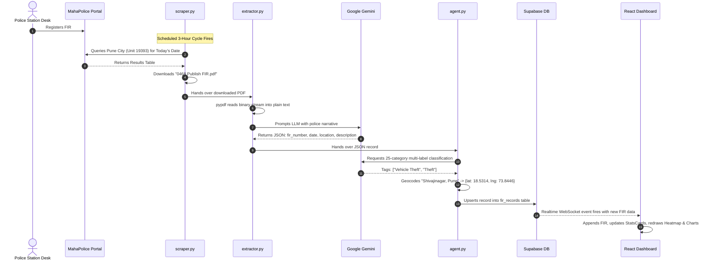

# Master Architecture Guide & Technical Defense: CrimeWatch Maharashtra

Welcome to your complete architectural walkthrough and project defense guide for **CrimeWatch Maharashtra** (your Bachelor Thesis / Capstone Project: **BTP**). 

This guide is structured from the ground up: starting with the core engineering purpose, breaking down every file and technology, analyzing the AI and geospatial algorithms, walking through execution and debugging workflows, and concluding with a mock viva/interview preparation session.

---

## 1. Project Purpose & System Overview

### The Problem
In India, state police departments register thousands of First Information Reports (FIRs) daily. While portals such as the **Maharashtra Police Citizen Portal** publish non-sensitive FIRs under public transparency mandates, this data is published as **unstructured, non-standardized PDFs** locked inside dynamic ASP.NET web forms. Law enforcement analysts, researchers, and citizens face major bottlenecks:
1. **Zero Standardization**: FIRs are scanned or text-based documents containing legal jargon, freeform police officer notes, mixed English and regional transliterations.
2. **No Geospatial Intelligence**: Incidents are listed with descriptive strings (e.g., *"Near Shaniwar Wada, Pune"*) rather than coordinates, making spatial hotspot analysis impossible.
3. **No Automatic Categorization**: FIRs cite IPC (Indian Penal Code) or BNS (Bharatiya Nyaya Sanhita) sections without standardized high-level categorical tagging.
4. **No Real-Time Monitoring**: Data has to be manually queried city-by-city, station-by-station.

### The Solution: CrimeWatch Maharashtra
This project is an **Automated End-to-End Crime Intelligence & Geospatial Analytics Pipeline**:
- **Automated Ingestion**: An autonomous Selenium scraper navigates the official Maharashtra Police portal across 5 key urban commissionerates (**Pune, Mumbai Main, Thane, Nashik, and Nagpur**), automatically fetching today's FIR PDFs on a 3-hour recurring loop.
- **LLM Information Extraction**: Google Gemini (`gemini-3.1-flash-lite` via LangChain) transforms messy police narrative text into structured JSON.
- **Agentic Multi-Label Crime Classification**: An AI classifier categorizes incidents strictly into **25 predefined official crime types** (e.g., *Online Financial Fraud, Vehicle Theft, Murder, Cybercrime*).
- **Geocoding & Hotspot Heatmapping**: Locations are resolved into geographic coordinates (`lat`, `lng`) via OpenStreetMap Nominatim with a deterministic centroid-jitter fallback.
- **Cloud Database with Real-Time Push**: Structured, enriched records are upserted into **Supabase (PostgreSQL)**, with duplicate prevention and automatic backfilling.
- **Command & Control Analytics Dashboard**: A high-performance React (Vite) interface rendering interactive **Leaflet Heatmaps**, Recharts trend and category charts, and live real-time WebSocket feeds without manual page reloads. A companion **FastAPI** REST backend is provided for external service integration.

---


## 2. Complete Folder Structure & Every File Explained

```
c:\Users\mahit\OneDrive\Desktop\BTP\
│
├── .env                       # Local environment variables (API keys, DB credentials)
├── .env.example               # Template for required environment keys
├── .gitignore                 # Excludes node_modules, __pycache__, PDFs, and .env
├── requirements.txt           # Python dependency declarations
├── README.md                  # Project overview and architecture notes
│
├── main.py                    # Master pipeline orchestrator & scheduler (3-hr daemon)
├── scraper.py                 # Selenium headless scraper for Maharashtra Police Portal
├── extractor.py               # PDF document parser & Gemini LLM structured data extractor
├── agent.py                   # 25-category multi-label classifier & geospatial geocoder
├── database.py                # Supabase PostgreSQL client & smart upsert / backfill logic
├── api_server.py              # FastAPI REST API exposing analytics & heatmap endpoints
│
├── check_db.py                # Diagnostic script: audits total vs. geocoded records in DB
├── check_coords_format.py     # Diagnostic script: inspects raw coordinates JSON format
├── fix_coordinates.py         # Batch utility: retroactively geocodes records missing coordinates
├── reclassify_records.py      # Batch utility: re-runs the 25-category LLM classifier over DB
├── view_records.py            # CLI viewer: dumps all records currently stored in Supabase
│
├── firs_downloaded/           # Local folder holding real FIR PDFs downloaded by Selenium
│
└── dashboard/                 # Modern React + Vite Single Page Application (SPA)
    ├── package.json           # Frontend dependencies (Leaflet, Recharts, Supabase JS)
    ├── index.html             # HTML5 root template with Leaflet styles & Google Fonts
    ├── tsconfig.json          # TypeScript / JSX configuration
    └── src/
        ├── main.jsx           # React DOM root entry point
        ├── App.jsx            # Core application state, filters, Supabase Realtime subscription
        ├── supabaseClient.js  # Supabase JS client instance initialization
        ├── index.css          # Glassmorphic dark-mode design system & animations
        └── components/
            ├── Header.jsx             # Top bar with status indicator & manual refresh trigger
            ├── Sidebar.jsx            # Navigation bar (Dashboard, Incidents, Map, Analytics)
            ├── StatsCards.jsx         # Metric counters (Total FIRs, Geocoded, Cities, Top Crime)
            ├── FiltersBar.jsx         # City dropdown & Crime category filter controls
            ├── CrimeMap.jsx           # Leaflet map with colored pulsing markers & heat layer
            ├── CrimeTrend.jsx         # Time-series AreaChart showing daily incident frequencies
            ├── CrimeDistribution.jsx  # Recharts horizontal BarChart of top crime categories
            └── RecordsTable.jsx       # Paginated tabular view with color-coded severity badges
```

### Detailed Breakdown of Every File

#### 1. Pipeline & Ingestion Engine
- [main.py](file:///c:/Users/mahit/OneDrive/Desktop/BTP/main.py):
  - Orchestrates the four-step pipeline: Scrape $\rightarrow$ Extract $\rightarrow$ Agentic Intelligence $\rightarrow$ Database Save.
  - Implements a continuous monitoring daemon with `REFRESH_INTERVAL_SECONDS = 10800` (3 hours) or single-run execution via the `--once` flag.
  - Configures standard output encoding to UTF-8 to prevent Windows terminal character crashes with Indic text.

- [scraper.py](file:///c:/Users/mahit/OneDrive/Desktop/BTP/scraper.py):
  - Contains configuration for the 5 target commissionerates: **Pune (19393)**, **Mumbai Main (19378)**, **Thane (19399)**, **Nashik (19408)**, and **Nagpur (19387)**.
  - Controls headless Google Chrome via `webdriver.ChromeOptions` and the Chrome DevTools Protocol (`Page.setDownloadBehavior`) to automate file downloads without popups.
  - Automates session initialization, dynamic date setting via JavaScript, ASP.NET postback handling, and detection of download completion.

- [extractor.py](file:///c:/Users/mahit/OneDrive/Desktop/BTP/extractor.py):
  - [extract_text_from_pdf()](file:///c:/Users/mahit/OneDrive/Desktop/BTP/extractor.py#L26-L46): Uses `pypdf.PdfReader` to extract text streams page-by-page, with fallback plain text readers.
  - [extract_structured_data()](file:///c:/Users/mahit/OneDrive/Desktop/BTP/extractor.py#L70-L125): Passes raw police text to Google Gemini (`gemini-3.1-flash-lite`) via LangChain to extract fields: `fir_number`, `date`, `location`, `description`, `complainant`, and `accused`.
  - [_regex_extract_fallback()](file:///c:/Users/mahit/OneDrive/Desktop/BTP/extractor.py#L47-L69): Robust regular-expression fallback that parses key fields if the Gemini API is offline or quota-limited.
  - [process_pdfs()](file:///c:/Users/mahit/OneDrive/Desktop/BTP/extractor.py#L126-L180): Queries Supabase beforehand and skips already-ingested FIRs to conserve API tokens.

- [agent.py](file:///c:/Users/mahit/OneDrive/Desktop/BTP/agent.py):
  - The cognitive core of the system.
  - [CRIME_CATEGORIES](file:///c:/Users/mahit/OneDrive/Desktop/BTP/agent.py#L15-L41): Array of exactly **25 official crime categories** (Theft, Burglary, Robbery, Assault, Cybercrime, Online Financial Fraud, Murder, etc.).
  - [classify_crime()](file:///c:/Users/mahit/OneDrive/Desktop/BTP/agent.py#L257-L332): Prompts Gemini with strict constraints to return only combinations of the 25 allowed categories.
  - [_normalize_category()](file:///c:/Users/mahit/OneDrive/Desktop/BTP/agent.py#L68-L134): Normalizes variations (e.g., *"cyber crime"* $\rightarrow$ *"Cybercrime"*, *"dowry death"* $\rightarrow$ *"Dowry-related Offences"*).
  - [_keyword_classify_fallback()](file:///c:/Users/mahit/OneDrive/Desktop/BTP/agent.py#L136-L255): Comprehensive heuristic engine checking IPC sections (e.g., Section 302 for Murder, 307 for Attempt to Murder, 379 for Theft, 420 for Cheating) and contextual keywords.
  - [geocode_location()](file:///c:/Users/mahit/OneDrive/Desktop/BTP/agent.py#L377-L426): Iteratively queries OpenStreetMap Nominatim with candidate strings.
  - [_city_centroid_fallback()](file:///c:/Users/mahit/OneDrive/Desktop/BTP/agent.py#L354-L375): Applies an MD5 hash of the location string to compute a deterministic jitter around known city coordinates so markers never cluster on a single point.

- [database.py](file:///c:/Users/mahit/OneDrive/Desktop/BTP/database.py):
  - Initializes the Supabase client using environment variables.
  - [save_to_database()](file:///c:/Users/mahit/OneDrive/Desktop/BTP/database.py#L22-L65): Intelligent upsert logic. Before inserting, it checks if `fir_number` exists. If an existing row has null coordinates, it updates it with the new coordinates and tags; otherwise, it skips duplicates to guarantee idempotent runs.

#### 2. Backend & Utilities
- [api_server.py](file:///c:/Users/mahit/OneDrive/Desktop/BTP/api_server.py):
  - FastAPI server with CORS middleware.
  - Exposes REST endpoints: `/api/records`, `/api/statistics`, `/api/crime-distribution`, `/api/city-distribution`, `/api/trend`, and `/api/heatmap-data` (which calculates point intensity based on crime severity).
- [view_records.py](file:///c:/Users/mahit/OneDrive/Desktop/BTP/view_records.py): Rapid CLI inspection script printing formatted JSON records from Supabase.
- [check_db.py](file:///c:/Users/mahit/OneDrive/Desktop/BTP/check_db.py): Audits the database to report how many records have valid coordinates ready for heat mapping.
- [fix_coordinates.py](file:///c:/Users/mahit/OneDrive/Desktop/BTP/fix_coordinates.py): Scans the database for records missing coordinates, runs geocoding, and writes the coordinates back.
- [reclassify_records.py](file:///c:/Users/mahit/OneDrive/Desktop/BTP/reclassify_records.py): Iterates through all existing DB rows to align crime tags with the 25 standard categories.

#### 3. Frontend Dashboard (`dashboard/`)
- [dashboard/src/App.jsx](file:///c:/Users/mahit/OneDrive/Desktop/BTP/dashboard/src/App.jsx):
  - Central React container maintaining client state (`records`, `filterCity`, `filterCrime`, `activePage`).
  - Sets up a **Supabase Realtime WebSocket** subscription (`supabase.channel('fir-realtime').on('postgres_changes', ...)`), appending new FIRs dynamically.
- [dashboard/src/components/CrimeMap.jsx](file:///c:/Users/mahit/OneDrive/Desktop/BTP/dashboard/src/components/CrimeMap.jsx):
  - Integrates React-Leaflet with dynamic tile providers (Free Dark Mode, Free OpenStreetMap, Free Esri HD Satellite, and optional CARTO).
  - Dynamically loads `leaflet.heat` to render a gradient heatmap alongside pulsing, color-coded severity markers (Red = High, Amber = Medium, Blue = Low).
- [dashboard/src/components/CrimeTrend.jsx](file:///c:/Users/mahit/OneDrive/Desktop/BTP/dashboard/src/components/CrimeTrend.jsx):
  - Visualizes temporal crime trends using a Recharts gradient `AreaChart`.
- [dashboard/src/components/CrimeDistribution.jsx](file:///c:/Users/mahit/OneDrive/Desktop/BTP/dashboard/src/components/CrimeDistribution.jsx):
  - Horizontal Recharts `BarChart` displaying top crimes and city-wise breakdowns.
- [dashboard/src/components/RecordsTable.jsx](file:///c:/Users/mahit/OneDrive/Desktop/BTP/dashboard/src/components/RecordsTable.jsx):
  - Responsive table showing complainant, accused, location, tags, and coordinates.

---

## 3. Technologies, Libraries, APIs & Databases

| Layer | Technology | Version / Specification | Role in the Project |
| :--- | :--- | :--- | :--- |
| **Automation** | **Selenium WebDriver** | `^4.x` | Headless Chrome automation; drives ASP.NET form submissions and captures downloads. |
| **Document Processing**| **PyPDF** | `^3.x` | Extracts text streams from downloaded binary PDF files. |
| **AI / Orchestration** | **LangChain** | `^0.2.x` | Orchestrates LLM chains, input prompt templates, and output parsers. |
| **Foundation Model** | **Google Gemini** | `gemini-3.1-flash-lite` | Zero-shot structured data extraction and 25-category multi-label crime classification. |
| **Geospatial API** | **OpenStreetMap Nominatim** | Public REST API | Converts unstructured location strings into WGS84 geographic coordinates (`lat`, `lng`). |
| **Cloud Database** | **Supabase (PostgreSQL)**| Postgres 15+ | Hosted relational database storing FIRs with JSONB coordinates and array tags. |
| **Realtime Engine** | **Supabase Realtime** | WebSocket Engine | Broadcasts `INSERT` and `UPDATE` events from Postgres to client browsers. |
| **Backend Framework** | **FastAPI + Uvicorn** | FastAPI 0.110+ | High-performance Python ASGI REST API serving processed analytics and endpoints. |
| **Frontend Framework**| **React + Vite** | React 18/19, Vite 8 | Fast build tool and reactive component library for the user interface. |
| **Mapping Engine** | **Leaflet + React-Leaflet**| Leaflet 1.9.4 | Interactive canvas map with tile switching, custom SVG pulsing markers, and popups. |
| **Heatmap Engine** | **Leaflet.heat** | 0.2.0 | Canvas-based Gaussian blur density heat overlay. |
| **Data Visualization**| **Recharts** | `^3.10.x` | Declarative SVG charting library for time series (`AreaChart`) and category distributions (`BarChart`). |

---

## 4. System Architecture & Connection Flow

The project implements a **Dual-Access Architecture**:
1. **Pipeline to Cloud DB**: The automated ingestion pipeline runs on the server/local worker and writes directly to Supabase via its Python SDK.
2. **Direct Real-Time Client Connection**: The React dashboard connects directly to Supabase via `@supabase/supabase-js` using public anonymous keys. This allows the client to fetch records and subscribe to live PostgreSQL WebSocket change events without polling the server.
3. **Decoupled REST API**: The FastAPI server provides a standardized API for external microservices, mobile apps, or BI tools.

```mermaid
graph TB
    subgraph "1. Ingestion Pipeline (Python Worker)"
        Portal["Maharashtra Police Portal<br/>(citizen.mahapolice.gov.in)"] -->|Selenium Headless| Scraper["scraper.py"]
        Scraper -->|PDFs| Storage["Local Disk (firs_downloaded/)"]
        Storage --> Extractor["extractor.py<br/>(pypdf Text Extraction)"]
        Extractor -->|Prompt + Context| Gemini["Google Gemini LLM<br/>(gemini-3.1-flash-lite)"]
        Gemini -->|Structured JSON| Agent["agent.py<br/>(Classifier & Geocoder)"]
        Agent -->|Nominatim API| OSM["OpenStreetMap Geocoding"]
        OSM -->|lat, lng| Agent
        Agent -->|Enriched Records| DBModule["database.py"]
    end

    subgraph "2. Cloud Storage & Realtime Hub"
        DBModule -->|SQL Upsert| Supabase[("Supabase PostgreSQL<br/>Table: fir_records")]
        Supabase -->|PostgreSQL CDC| RealtimeEngine["Supabase Realtime Engine<br/>(WebSockets)"]
    end

    subgraph "3. Presentation & Analytics"
        RealtimeEngine -->|Push Notification (INSERT)| ReactApp["React + Vite Dashboard<br/>(App.jsx)"]
        Supabase -->|Initial Data Fetch| ReactApp
        ReactApp --> Leaflet["Leaflet.js<br/>(Heatmap + Markers)"]
        ReactApp --> Recharts["Recharts<br/>(Trends & Categories)"]
        
        Supabase -->|Read Aggregates| FastAPI["FastAPI REST Server<br/>(api_server.py :5000)"]
        FastAPI -->|JSON Endpoints| External["External Clients / API Consumers"]
    end
```

---

## 5. End-to-End Workflow with a Concrete Example

Let's trace a real incident through the entire pipeline:



### Trace Data Transformation:

#### Step 1: Raw FIR Text (Extracted from PDF)
```text
FIRST INFORMATION REPORT (Under Section 154 Cr.P.C.)
1. District: PUNE CITY, P.S.: Shivajinagar, Year: 2026, FIR No: 0468, Date: 26/10/2026
2. Place of Occurrence: Near FC Road, Deccan Gymkhana, Shivajinagar, Pune
3. Complainant: Rahul S. Deshmukh
4. Accused: Unknown person
5. Brief Description: Complainant parked his Hero Splendor motorcycle (MH-12-AB-1234) 
   outside Cafe Goodluck. At around 14:30 hrs, unknown accused stole the vehicle.
```

#### Step 2: Extractor Output (JSON from Gemini)
```json
{
  "fir_number": "0468",
  "date": "26/10/2026",
  "location": "Near FC Road, Deccan Gymkhana, Shivajinagar, Pune",
  "description": "Complainant parked his Hero Splendor motorcycle outside Cafe Goodluck. Unknown accused stole the vehicle.",
  "complainant": "Rahul S. Deshmukh",
  "accused": "Unknown person"
}
```

#### Step 3: Enriched Record (After Agentic Layer)
```json
{
  "fir_number": "0468",
  "date": "26/10/2026",
  "location": "Near FC Road, Deccan Gymkhana, Shivajinagar, Pune",
  "description": "Complainant parked his Hero Splendor motorcycle outside Cafe Goodluck. Unknown accused stole the vehicle.",
  "complainant": "Rahul S. Deshmukh",
  "accused": "Unknown person",
  "crime_tags": ["Vehicle Theft", "Theft"],
  "coordinates": {
    "lat": 18.5196,
    "lng": 73.8415
  }
}
```

#### Step 4: UI Representation
- **Stats Card**: Total FIRs increments by 1; Pune count increments by 1.
- **Map View**: A blue/pulsing marker drops at `(18.5196, 73.8415)`. The Leaflet Heatmap adds a density kernel at this coordinate.
- **Charts**: "Vehicle Theft" and "Theft" bar heights increment; the daily trend updates.

---

## 6. Deep Dive: AI, LLM & Geospatial Logic

### 1. Why LLM over Traditional RegEx / NLP?
Police FIRs in India do not follow a single schema. Across different commissionerates, date formats alternate between `DD/MM/YYYY`, `DD-MM-YYYY`, and spoken text. Complainant details may appear as headers or inside running paragraphs.
- **Zero-Shot Understanding**: Google Gemini (`gemini-3.1-flash-lite`) interprets context rather than rigid positions.
- **Low Latency & High Rate-Limits**: The `flash-lite` model processes extraction in under 1 second, fitting within standard API tiers.

### 2. Multi-Label Classification Design
In criminal law, a single incident can constitute multiple offenses (e.g., snatching a purse at knifepoint is both **Snatching** and **Robbery**). The system addresses this with:
- **Strict Constrained Prompting**: The LLM is provided with the numbered list of the 25 allowed categories and instructed to select strictly from them, returning comma-separated values.
- **Normalization Pipeline**: [_normalize_category()](file:///c:/Users/mahit/OneDrive/Desktop/BTP/agent.py#L68) uses regex to strip numbering, bullets, and labels, maps slash-variations, and uses an alias dictionary (e.g., *"dowry harassment"* $\rightarrow$ *"Dowry-related Offences"*).
- **Rule-Based Heuristic Safety Net**: If the LLM call encounters network or quota errors, [_keyword_classify_fallback()](file:///c:/Users/mahit/OneDrive/Desktop/BTP/agent.py#L136) parses the description for specific IPC/BNS sections and keywords:
  - *IPC 302, "murder", "dead body found"* $\rightarrow$ `Murder`
  - *IPC 307, "tried to kill", "attacked with knife"* $\rightarrow$ `Attempt to Murder`
  - *IPC 420, "cheated", "fake promise", "investment scam"* $\rightarrow$ `Cheating / Fraud`
  - *"UPI", "OTP", "part-time job scam", "phishing"* $\rightarrow$ `Online Financial Fraud` + `Cybercrime`

### 3. Geospatial Geocoding & Centroid Jitter
Converting police address text into map points presents two challenges:
1. **Query Ambiguity**: A query for *"Panchavati"* without context could return places in other states. The pipeline mitigates this through progressive candidate queries:
   - Candidate 1: `"{location_name}, Maharashtra, India"`
   - Candidate 2: Sub-locality parsing (e.g., extracting `"Pune, Maharashtra, India"` from `"FC Road, Pune"`)
2. **Coordinate Stacking Problem**: When multiple FIRs occur in the same police jurisdiction without a street address, standard geocoders return the exact same town centroid coordinates. Ten markers placed at identical coordinates would stack into a single marker.
   - **The Solution**: [_city_centroid_fallback()](file:///c:/Users/mahit/OneDrive/Desktop/BTP/agent.py#L354) applies a **deterministic pseudo-random jitter** using an MD5 hash of the location string:
   $$\text{hash} = \text{MD5}(\text{location\_string})$$
   $$\Delta \text{lat} = \left(\frac{\text{hash} \pmod{1000}}{1000.0} - 0.5\right) \times 0.015$$
   $$\Delta \text{lng} = \left(\frac{(\text{hash} / 1000) \pmod{1000}}{1000.0} - 0.5\right) \times 0.015$$
   This slightly displaces points across the city sector, keeping markers distinct while maintaining spatial accuracy within the neighborhood.

---

## 7. How to Run, Debug, Modify, and Test

### Prerequisites
- **Python 3.10+**
- **Node.js 18+** & npm
- **Google Chrome** installed (for Selenium)
- Valid API keys: Google Gemini API Key and Supabase project credentials.

### Step-by-Step Execution Guide

#### Terminal 1: Ingestion Pipeline
To run the automated monitoring daemon (refreshes every 3 hours):
```powershell
python main.py
```
To run a single test cycle without entering the 3-hour loop:
```powershell
python main.py --once
```

#### Terminal 2: FastAPI Analytics Backend (Optional)
```powershell
python api_server.py
```
*Accessible at: `http://localhost:5000` | Interactive Swagger API docs: `http://localhost:5000/docs`*

#### Terminal 3: React Vite Dashboard
```powershell
cd dashboard
npm install       # First-time setup
npm run dev
```
*Open your browser at: `http://localhost:5173`*

---

### Verification and Diagnostic Toolkit

You have dedicated scripts to test and inspect individual system layers:

1. **Verify Records in Database**:
   ```powershell
   python view_records.py
   ```
   Dumps all stored FIRs directly from Supabase to your console.

2. **Audit Heatmap Readiness (Coordinate Coverage)**:
   ```powershell
   python check_db.py
   ```
   Reports total records vs. records with valid `{lat, lng}` coordinates.

3. **Batch Re-Geocoding**:
   ```powershell
   python fix_coordinates.py
   ```
   Scans for any records in Supabase missing coordinates and updates them.

4. **Batch Reclassification**:
   ```powershell
   python reclassify_records.py
   ```
   Re-evaluates descriptions for all records against the 25 official categories.

---

### Common Debugging Scenarios

| Issue | Root Cause | Solution |
| :--- | :--- | :--- |
| **Selenium times out on the portal** | Portal is slow or undergoing maintenance. | `scraper.py` includes a 20-second explicit wait (`WebDriverWait(driver, 20)`). Check if the portal is reachable in a standard browser. |
| **LLM returns 429 Quota Exceeded** | Free Gemini tier per-minute limit reached. | The system automatically falls back to `_regex_extract_fallback()` in `extractor.py` and `_keyword_classify_fallback()` in `agent.py`. Pipeline execution will continue uninterrupted. |
| **Map markers are not visible** | Records have null coordinates. | Run `python fix_coordinates.py` to retroactively calculate and update coordinates in the database. |
| **CORS errors on API calls** | Frontend URL not permitted by backend. | `api_server.py` has `CORSMiddleware` configured with `allow_origins=["*"]`. Ensure the FastAPI server is running on port 5000. |

---

## 8. Project Viva & Technical Interview Preparation

Here are key questions examiners and technical interviewers may ask about this project, along with recommended answers.

### Architectural & Systems Questions

#### Q1: "Why did you use Selenium instead of a faster library like BeautifulSoup or Scrapy?"
> **Answer:**  
> "The Maharashtra Police Citizen Portal is built on Microsoft ASP.NET Web Forms. It relies heavily on server-side ViewState, postbacks, and client-side JavaScript to populate cascading dropdowns (such as choosing a district code to load police stations). Simple HTTP scrapers like `requests` or `BeautifulSoup` cannot execute the client JavaScript required to trigger postbacks or simulate file downloads. Selenium automates a real browser session, maintains cookies, and handles file download events through the Chrome DevTools Protocol."

#### Q2: "Why does the frontend connect directly to Supabase if you also have a FastAPI server?"
> **Answer:**  
> "This uses a dual-access pattern. Supabase exposes a PostgreSQL database via PostgREST and WebSockets. Connecting the React frontend directly to Supabase using `@supabase/supabase-js` enables zero-latency, real-time updates via PostgreSQL change streams (`postgres_changes`). The FastAPI server is decoupled to handle analytical aggregations, compute intensity weights for the heatmap layer, and provide a REST API for third-party consumers."

#### Q3: "How do you handle duplicate FIR downloads across consecutive 3-hour scraping cycles?"
> **Answer:**  
> "De-duplication is enforced at two levels:
> 1. **Extractor Level**: `process_pdfs()` in `extractor.py` queries Supabase first and cross-references existing FIR numbers, skipping PDFs that are already stored with coordinates.
> 2. **Database Level**: `save_to_database()` in `database.py` executes a `select().eq('fir_number', fir_no)` check before insertion. If the FIR exists but lacks coordinates, it updates the record; if it already has coordinates, it skips insertion."

---

### AI & Data Processing Questions

#### Q4: "Why use Google Gemini instead of a local BERT model or rule-based regex?"
> **Answer:**  
> "First Information Reports contain complex narratives with non-standardized phrasing, typos, and transliterated Indian names. Fine-tuning a local BERT or NER model requires thousands of annotated FIRs, which are difficult to source and maintain. Google Gemini provides strong zero-shot comprehension across varied formats. Additionally, we implemented a rule-based fallback system (`_regex_extract_fallback` and `_keyword_classify_fallback`) that checks IPC sections, ensuring the system remains functional even during API outages."

#### Q5: "How does the multi-label classification system work?"
> **Answer:**  
> "The classifier assigns one or more labels strictly from a predefined set of 25 official categories. The prompt provides these categories and enforces a comma-separated output format without extra narrative. A normalization function (`_normalize_category`) cleans and maps variations to canonical names. If the LLM is unreachable, our heuristic engine maps specific keywords and legal sections (e.g., Section 302 for Murder, Section 379 for Theft, Section 420 for Fraud)."

#### Q6: "How did you solve the problem of multiple FIRs stacking at the same coordinates?"
> **Answer:**  
> "When multiple incidents occur in the same police station jurisdiction without a specific street address, geocoders return identical coordinates, causing markers to stack directly on top of each other. In `_city_centroid_fallback()` in `agent.py`, we implemented a deterministic jitter algorithm using an MD5 hash of the location string. This distributes the points slightly around the neighborhood centroid in a consistent manner across re-renders without altering the general spatial accuracy."

---

### Database & Security Questions

#### Q7: "What schema is used in Supabase PostgreSQL?"
> **Answer:**  
> "The table is named `fir_records`. Key columns include:
> - `id`: UUID / Primary Key
> - `fir_number`: Text (indexed, unique identifier)
> - `date`: Text / Date of occurrence
> - `location`: Text
> - `description`: Text
> - `complainant`: Text
> - `accused`: Text
> - `crime_tags`: JSONB / Array of strings (the 25 categories)
> - `coordinates`: JSONB (`{"lat": float, "lng": float}`)
> - `created_at`: Timestamp with time zone"

#### Q8: "How does the heatmap determine point intensity?"
> **Answer:**  
> "In both `CrimeMap.jsx` and `api_server.py`, heat intensity is weighted by crime severity rather than a simple count:
> - **Violent / Severe Crimes** (*Murder, Rape, Kidnapping, Robbery*): Assigned higher weights ($0.85 - 1.0$).
> - **Property / Non-Violent Crimes** (*Theft, Cheating, Trespass*): Assigned baseline weights ($0.5 - 0.7$).  
> This ensures high-severity incidents are clearly highlighted on the thermal density map."

---

### Future Enhancements & Defense Summary
When asked how this system can be extended in production:
1. **OCR Integration for Scanned FIRs**: Integrate Tesseract OCR or Google Cloud Vision to process scanned and handwritten Marathi FIRs.
2. **Predictive Spatio-Temporal Modeling**: Apply ST-DBSCAN (Spatial-Temporal Clustering) or an LSTM/ARIMA model on historical data to forecast emerging hotspots.
3. **IPC to BNS Transition**: Update legal section mappings to support the new *Bharatiya Nyaya Sanhita (BNS)* criminal code.

---

### Quick Reference of All Linked Source Code
- **Pipeline Coordinator**: [main.py](file:///c:/Users/mahit/OneDrive/Desktop/BTP/main.py)
- **Portal Scraper**: [scraper.py](file:///c:/Users/mahit/OneDrive/Desktop/BTP/scraper.py)
- **Data Extractor**: [extractor.py](file:///c:/Users/mahit/OneDrive/Desktop/BTP/extractor.py)
- **AI Agent & Geocoder**: [agent.py](file:///c:/Users/mahit/OneDrive/Desktop/BTP/agent.py)
- **Database Layer**: [database.py](file:///c:/Users/mahit/OneDrive/Desktop/BTP/database.py)
- **FastAPI Server**: [api_server.py](file:///c:/Users/mahit/OneDrive/Desktop/BTP/api_server.py)
- **React Frontend**: [App.jsx](file:///c:/Users/mahit/OneDrive/Desktop/BTP/dashboard/src/App.jsx)
- **Interactive Map**: [CrimeMap.jsx](file:///c:/Users/mahit/OneDrive/Desktop/BTP/dashboard/src/components/CrimeMap.jsx)
